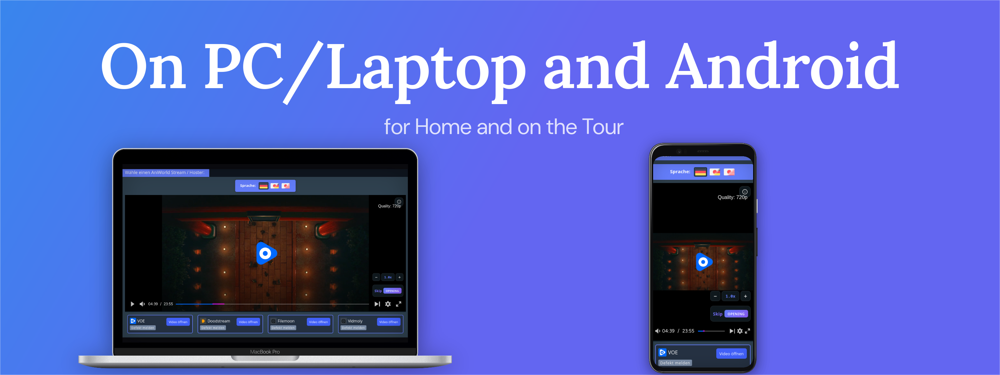
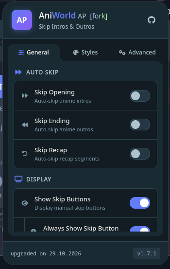
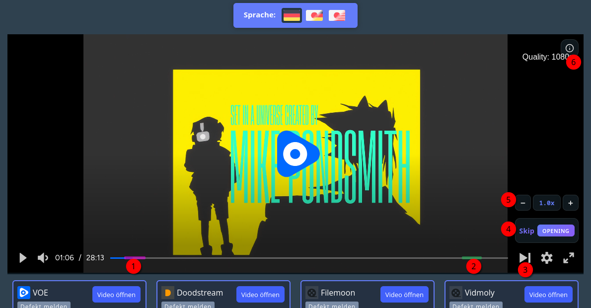

# AniWorld AP Fork

<p align="center">
  
</p>

A Firefox extension that auto-skips openings (OP) and endings (ED) on [aniworld.to](https://aniworld.to) using the [AniSkip](https://api.aniskip.com) API, plus the extra features listed below.

> [!NOTE]
> **Works on mobile too** — AniWorld AP runs in Firefox for Android just like on desktop. Install it from
> [addons.mozilla.org](https://addons.mozilla.org/en-US/firefox/addon/aniworld-autoplay-fork/) on your phone: the overlay scales
> with the player, the settings popup is the same, and nothing needs to be configured differently.

<p align="center">
  
</p>

<p align="center">
  
</p>

<p align="center"><em>The numbers mark the overlay controls: 1 opening marker, 2 ending marker, 3 next-episode button, 4 skip button, 5 speed control, 6 info toggle.</em></p>

## Installation

### From Mozilla Add-ons

[](https://addons.mozilla.org/en-US/firefox/addon/aniworld-autoplay-fork/)

Install the signed build from addons.mozilla.org. Updates are delivered automatically.

### From a release ZIP (temporary)

1. Download the `.zip` from the [latest release](https://github.com/sioXD/Aniworld-AP/releases/latest) and extract it.
2. Open `about:debugging#/runtime/this-firefox` in Firefox.
3. Click **Load Temporary Add-on…** and select the extracted `manifest.json`.

Temporary add-ons are removed when Firefox restarts. For a permanent install use the AMO build (or a self-built signed `.xpi`).

### Requirements

- Firefox **142.0** or newer (desktop or Android).
- The extension only activates inside the VOE player iframe on `aniworld.to` and needs network access to the AniSkip API.

## Fork Changes

This fork adds the following features to enhance the viewing experience on AniWorld.to.

### Added

- **Speed Control** - Adjust playback speed (0.25× to 5×) via -/+ buttons, click center to reset to 1×
- **Speed Control Settings** - Toggle speed buttons on/off (+ Remember speed across episodes)
- **Next Episode** - Navigate automatically at the end of an episode or manually with the next-episode button in the player
- **Always Show Skip Button** - Skip 90s if no OP/ED is playing
- **Version** and the **update date** are now shown

### Changes

- **Redesigned Skip Button** - design matching the speed control, gradient moved to the type badge
- **Layout** - Controls rearranged: info toggle at top-right, skip/speed/panel at bottom
- **Info Toggle** - Info icon (top-right) replaces double-arrow, opens the AniSkip panel

## Development

### Requirements

- Firefox 142+ for testing
- [Node.js](https://nodejs.org/) + `npm install --global web-ext` (packaging only)

### Local development

1. Edit the files under `src/`.
2. Open `about:debugging#/runtime/this-firefox` → **Load Temporary Add-on…** → `manifest.json`.
3. Reload the extension in `about:debugging` and refresh the aniworld.to page after every change.
4. Test on aniworld.to with various anime/episodes

### Packaging

```powershell
# Windows
pack.ps1
```

```bash
# Linux / macOS
./pack.sh
```

Both scripts stamp the current version and date into `src/popup.html` and build a ZIP into `web-ext-artifacts/` via `web-ext build`. `web-ext` must be installed globally.

### Releasing (CI/CD)

Change the `version` field in `manifest.json` to the next version and push the change to `main`:

```bash
# Set "version": "1.6.8" in manifest.json first.
git add manifest.json
git commit -m "bump version to 1.6.8"
git push origin main
```

The release workflow compares the previous and current manifest versions. When the version changes, it automatically creates the matching `v<version>` tag and GitHub Release with the built extension ZIP. Manifest changes that do not change the version do not create a release. If `AMO_ENABLED` and the AMO secrets are configured, the signed extension is also published to AMO.
